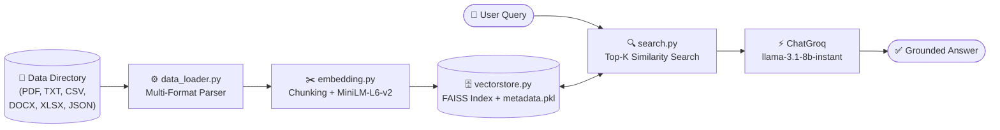

<div align="center">

# ⚡ Modular RAG Pipeline
### *Multi-Format Document Intelligence with Local Embeddings, FAISS & Groq*

[](https://www.python.org/)
[](https://python.langchain.com/)
[](https://github.com/facebookresearch/faiss)
[](https://groq.com/)
[](https://huggingface.co/sentence-transformers/all-MiniLM-L6-v2)

<p align="center">
  A lightweight, modular <b>Retrieval-Augmented Generation (RAG)</b> engine designed for fast local indexing and ultra-low-latency question answering across heterogeneous document formats.
</p>

[Features](#-key-highlights) • [Architecture](#-system-architecture) • [Project Structure](#-project-structure) • [Quick Start](#-quick-start) • [Configuration](#%EF%B8%8F-configuration) • [Roadmap](#-roadmap)

</div>

---

## ✨ Key Highlights

| Capability | Description |
| :--- | :--- |
| 📂 **Universal Ingestion** | Automatically detects and loads `PDF`, `TXT`, `CSV`, `DOCX`, `XLSX`, and `JSON` files from a single directory. |
| ✂️ **Context-Aware Chunking** | Uses `RecursiveCharacterTextSplitter` with configurable overlap to preserve semantic continuity. |
| 🧠 **Zero-Cost Local Embeddings** | Encodes chunks into 384-dimensional dense vectors locally via `SentenceTransformers` (`all-MiniLM-L6-v2`). |
| 💾 **Persistent FAISS Indexing** | Builds once and reloads `faiss.index` + `metadata.pkl` instantaneously on subsequent runs. |
| ⚡ **Sub-Second LLM Synthesis** | Connects retrieved top-K context directly to Groq's `llama-3.1-8b-instant` for grounded, hallucination-resistant answers. |

---

## 🧭 System Architecture



---

## 📁 Project Structure

```text
RAG/
├── data/                       # Drop your raw documents here
├── faiss_store/                # Auto-generated FAISS index & metadata store
│   ├── faiss.index
│   └── metadata.pkl
├── notebook/                   # Prototyping & experiment notebooks
├── src/
│   └── rag/
│       ├── __init__.py
│       ├── data_loader.py      # Multi-format document ingestion engine
│       ├── embedding.py        # Text splitting & dense vector generation
│       ├── vectorstore.py      # FAISS indexing, persistence & L2 search
│       └── search.py           # End-to-end retrieval + Groq LLM orchestration
├── .env                        # Secret keys (excluded from version control)
├── app.py                      # Application entry point
├── pyproject.toml              # Project metadata
├── requirements.txt            # Pinned dependencies
└── README.md                   # Documentation
```

---

## 🚀 Quick Start

### 1. Clone & Set Up Environment
```powershell
git clone <your-repository-url>
cd RAG

python -m venv .venv
.\.venv\Scripts\Activate.ps1
```

### 2. Install Dependencies
```powershell
pip install langchain-community langchain-text-splitters langchain-groq sentence-transformers python-dotenv faiss-cpu numpy pypdf docx2txt openpyxl
```

### 3. Configure Environment Variables
Create a `.env` file in the root directory:
```env
GROQ_API_KEY=your_groq_api_key_here
# Optional: removes Hugging Face unauthenticated request warnings
HF_TOKEN=your_huggingface_token_here
```

### 4. Add Documents & Run
Place your files inside the `data/` folder and launch the pipeline:
```powershell
python app.py
```

---

## 💻 Code Example

```python
from src.rag.search import RAGSearch

if __name__ == "__main__":
    # Automatically loads existing FAISS index or builds a new one from data/
    rag = RAGSearch(
        persist_dir="faiss_store",
        embedding_model="all-MiniLM-L6-v2",
        llm_model="llama-3.1-8b-instant",
    )

    query = "What are the phases of the Software Development Life Cycle?"
    answer = rag.search_and_summarize(query, top_k=3)

    print(f"\n❓ Query: {query}")
    print(f"\n💡 Answer:\n{answer}")
```

---

## ⚙️ Configuration

Customize pipeline behavior directly through class parameters:

| Parameter | Default Value | Location | Purpose |
| :--- | :--- | :--- | :--- |
| `chunk_size` | `1000` | `EmbeddingPipeline` / `FaissVectorStore` | Maximum character length per document chunk |
| `chunk_overlap` | `200` | `EmbeddingPipeline` / `FaissVectorStore` | Overlapping characters between adjacent chunks |
| `embedding_model` | `all-MiniLM-L6-v2` | `EmbeddingPipeline` / `RAGSearch` | SentenceTransformer model (384-dim output) |
| `llm_model` | `llama-3.1-8b-instant` | `RAGSearch` | Groq-hosted LLM used for answer synthesis |
| `top_k` | `5` | `search_and_summarize()` | Number of most relevant chunks retrieved per query |

---

## 🗺️ Roadmap

- [x] Multi-format document loader (`PDF`, `TXT`, `CSV`, `DOCX`, `XLSX`, `JSON`)
- [x] Local SentenceTransformer embedding pipeline
- [x] Persistent FAISS vector store with metadata serialization
- [x] Groq LLM integration for grounded question answering
- [ ] Source citations & page numbers in generated answers
- [ ] Interactive CLI / Streamlit web interface
- [ ] Hybrid search (BM25 + Dense Vector Reranking)

---

<div align="center">
  <sub>Built with Python, LangChain, FAISS & Groq • Designed for speed, modularity, and clarity.</sub>
</div>